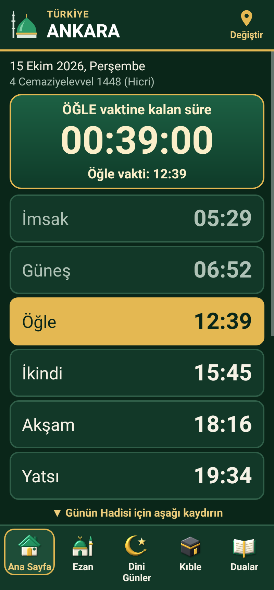
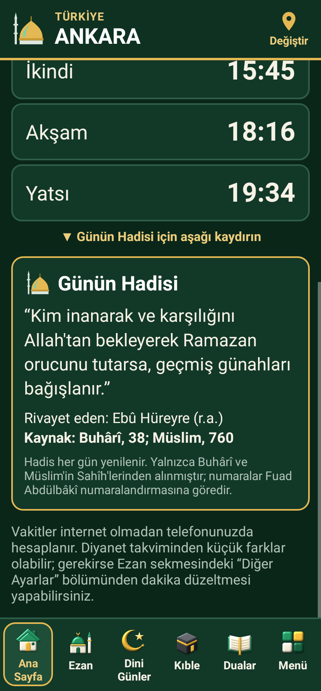
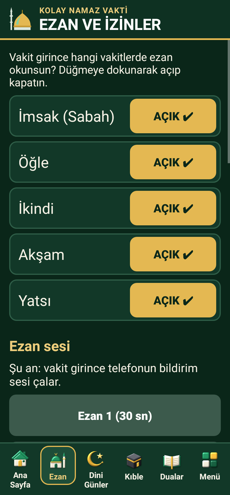
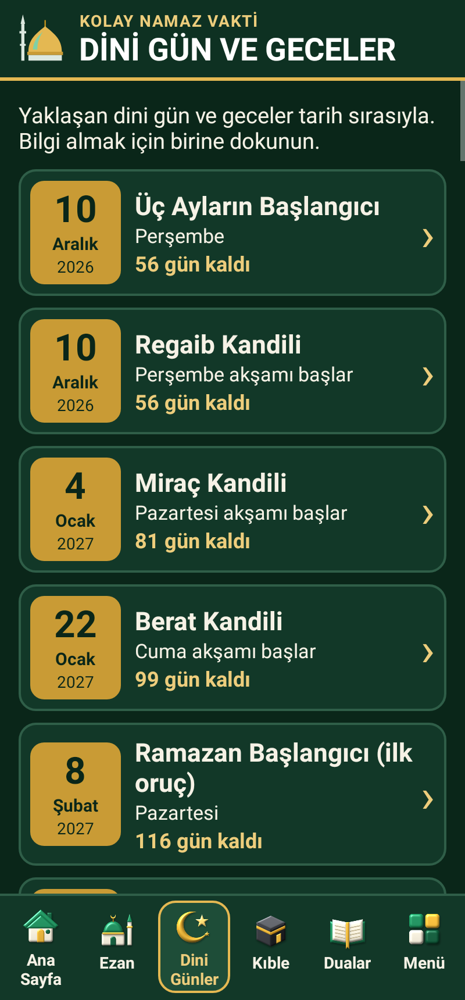
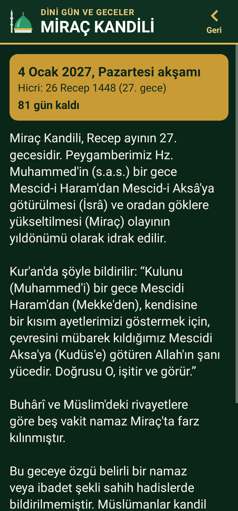
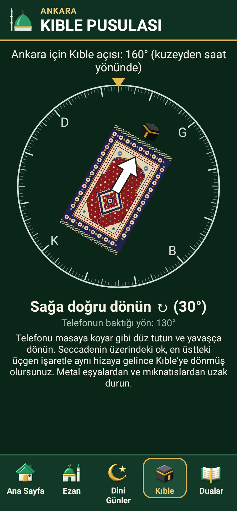
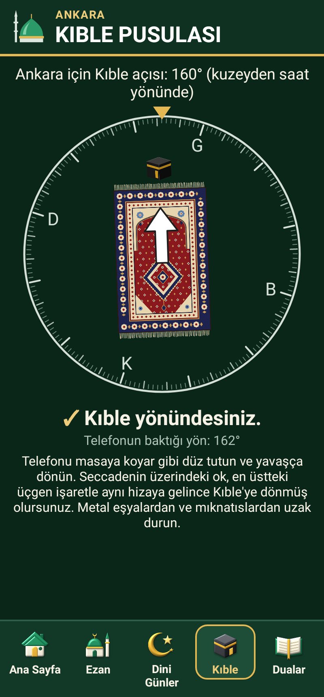
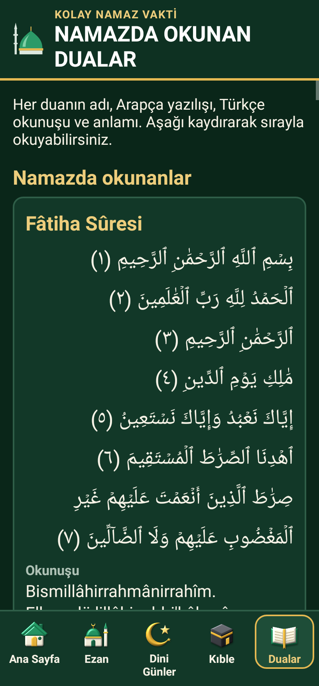
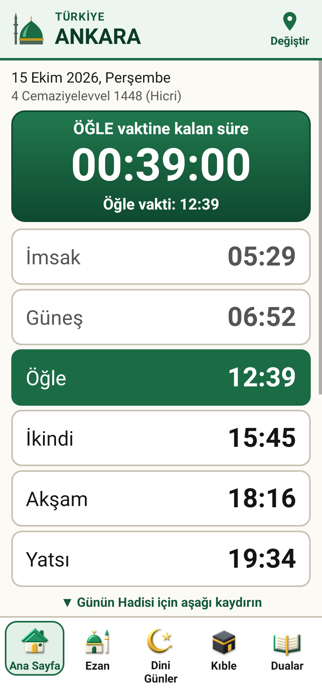
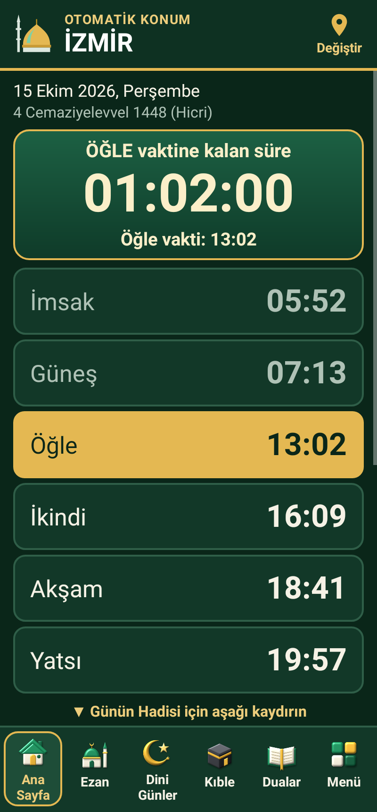

# Kolay Namaz Vakti

Yaşlıların da rahatça kullanabileceği, **büyük yazılı ve sade** bir namaz vakti uygulaması (Android).
İnternet gerekmez; reklam ve takip yoktur.

  
    

## 2.2 sürümünde neler değişti?

- **Otomatik konum.** Şehir seçme sayfasında **"Konumumu Otomatik Bul ve Takip Et"** düğmesine bir kez basın.
  Bundan sonra uygulamayı her açtığınızda telefon konumuna bakar; başka bir şehre gittiyseniz vakitler,
  alarmlar ve Kıble açısı kendiliğinden oraya göre güncellenir (5 km'den az yer değiştirmede bir şey yapılmaz).
  - Konum **yalnızca uygulama ekrandayken** okunur; arka planda konum izni istenmez. Yani başka şehre
    gidince uygulamayı **bir kez açmanız** gerekir; açmadan önce ezan eski şehrin vaktinde okunur.
  - Konum telefondan dışarı gönderilmez (uygulamanın internet izni yoktur).
  - Başlıkta en yakın **il merkezinin** adı yazar (100 km'den uzaksa veya yurt dışındaysanız "Konumum").
    Vakitler ise tam bulunduğunuz noktaya göre hesaplanır.
  - Listeden elle şehir seçerseniz otomatik konum kapanır.
- **Koyu yeşil görünüm (varsayılan).** Koyu yeşil zemin, krem yazı, altın vurgular. İsteyen
  **Ezan → Yazı Boyutu ve Vakit Düzeltme → "Görünüm"** düğmesinden **Açık** görünüme (açık zemin, koyu yeşil vurgu) geçebilir.
  Karşıtlık oranları ([WCAG 2.1](https://www.w3.org/TR/WCAG21/#contrast-minimum) ölçüsüyle): koyu görünümde yazı/zemin 14,39:1,
  altın düğme üzerindeki yazı 8,65:1; açık görünümde yeşil üzerinde beyaz yazı 6,49:1.
- **3 boyutlu görünümlü menü simgeleri.** Alt menüdeki 5 simge kabartmalı ve gölgeli olarak yeniden çizildi
  (ev, cami, hilal-yıldız, Kâbe, kitap). Hazır resim değil; `tools/menu_simgeleri_uret.py` ile kodla üretilir.
- **Düzeltilen hatalar:**
  - Seçilen ezan dosyası silinmiş veya açılamıyorsa vakit **sessiz** geçiyordu; artık telefonun bildirim sesiyle bildirim gelir.
  - Telefonun alt gezinme çubuğu açık temada beyaz zemin üzerinde beyaz düğmelerle görünmez kalabiliyordu; koyu renge alındı.
  - Konumla bulunan yerde başlıkta her zaman "TÜRKİYE" yazıyordu (yurt dışında da); artık "OTOMATİK KONUM" yazar.
  - Otomatik konumda telefonun saat dilimi değişince (yurt dışına çıkış) vakitler eski saat diliminde kalıyordu.

 

## 2.1 sürümünde neler değişti?

- **Renkler turkuaz oldu** (2.2'de koyu yeşile çevrildi). Ana renk `#11979A`, yazılar ve ince ayrıntılar için koyu turkuaz `#0A7275`.
  Örnek görseldeki açık turkuaz (`#1FB5B7`) üzerinde beyaz yazının karşıtlığı 2,51:1'dir. Bu oran, [WCAG 2.1](https://www.w3.org/TR/WCAG21/#contrast-minimum)
  okunabilirlik kuralının büyük yazılar için istediği 3:1'in altında kalır. Bu yüzden biraz daha koyu bir turkuaz seçildi
  (beyaz yazıyla 3,55:1; koyu turkuaz yazı, beyaz zeminde 5,71:1).
- **Başlıklar yenilendi.** Her sayfanın üstünde solda bir **cami simgesi**, küçük harfle üst başlık (ör. TÜRKİYE),
  altında büyük başlık (ör. ANKARA) var. Ana sayfada sağda **Değiştir** (şehir), dini gün sayfasında **Geri** düğmesi bulunuyor.
- **Ana sayfa ekrana sığıyor.** Vakit satırları ekranın boyuna göre kendini ayarlıyor, 6 vaktin hepsi kaydırmadan görünüyor
  (küçük ekranlı telefon için de test edildi). Sayacın altındaki "saat : dakika : saniye" yazısı kaldırıldı.
- **Kıble pusulası düzeltildi ve yeniden çizildi:**
  - Telefon eğik veya dik tutulduğunda yönün şaşması düzeltildi.
  - Jiroskopu olmayan telefonlarda da çalışıyor.
  - Ekran yan dönünce oluşan kayma giderildi.
  - Pusula ayarı bozuksa uyarı ayrı bir satırda gösteriliyor, yön bilgisini kapatmıyor.
  - Yeni görünüm: çentikli halka, K-D-G-B harfleri, desenli seccade, üstünde Kâbe ve beyaz ok.
    Doğru yöne dönünce "✓ Kıble yönündesiniz." yazıyor.
- **Uygulama simgesi** depo sahibinin verdiği hilal ve cami logosuyla değiştirildi.

## Telefona kurulum (adım adım)

1. Telefonunuzdan bu sayfadaki **`dist/KolayNamazVakti.apk`** dosyasına dokunun, sonra **İndir** (Download) düğmesine basın.
2. İndirme bitince bildirime veya **Dosyalarım → İndirilenler** içindeki `KolayNamazVakti.apk` dosyasına dokunun.
3. Telefon "Bilinmeyen uygulamalar" uyarısı verirse **Ayarlar**'a dokunun, **"Bu kaynağa izin ver"** seçeneğini açın, geri dönün.
4. **Yükle**'ye basın. Google Play Protect uyarı verirse **"Yine de yükle"** deyin (uygulama Google Play'den gelmediği için bu uyarı normaldir).
5. Uygulamayı açın, şehrinizi seçin. Bildirim izni sorulursa **İzin ver** deyin.

> **2.0 veya 2.1 sürümü kuruluysa:** 2.2 aynı anahtarla imzalandı, doğrudan üzerine kurulur. Ayarlarınız silinmez.
>
> **1.0 sürümü kuruluysa:** Bu sürüm farklı bir imza anahtarıyla imzalandı. Telefon "uygulama yüklenmedi"
> derse önce eski Kolay Namaz Vakti'yi kaldırın (uygulama simgesine basılı tutun → **Kaldır**), sonra yeniden yükleyin.
> Şehir ve ayarlarınızı yeniden seçmeniz gerekir.

**Gereken:** Android 7.0 veya daha yeni bir telefon.

APK dosyasının SHA-256 özeti (dosyanın bozulmadığını kontrol etmek isteyenler için):
`46ed823962645c03f5fbe1c2b2212a9612b44ef0f02918ccbfc9da11a0ec7156`

## Neler var?

Ekranın en altında 5 büyük menü düğmesi vardır:

| Düğme | Ne yapar? |
|---|---|
| **Ana Sayfa** | Sıradaki vakte kalan süre büyük yazıyla sayılır (ör. `00:39:00` = saat:dakika:saniye). Altında bugünün 6 vakti (İmsak, Güneş, Öğle, İkindi, Akşam, Yatsı). Sayfayı **aşağı kaydırınca** her gün değişen **"Günün Hadisi"** çıkar. |
| **Ezan** | Her vakit için ezanı **açıp kapatma**, ezan ses dosyası seçme ve deneme, vakitten önce hatırlatma ve ezanın zamanında okunması için gereken **izinlerin durumu** (✔ / kırmızı ✖ ve düzeltme düğmesi). Yazı boyutu ve dakika düzeltmesi de buradan açılır. |
| **Dini Günler** | Yaklaşan dini gün ve geceler tarih sırasıyla, "kaç gün kaldı" bilgisiyle. Birine dokununca **bilgi sayfası** açılır (ne olduğu, ilgili ayet ve hadisler, kaynakları). |
| **Kıble** | Pusula halkasının ortasında Kâbe yönüne dönen desenli bir **seccade**, üstünde Kâbe ve beyaz ok. Ok, en üstteki üçgenle aynı hizaya gelince "✓ Kıble yönündesiniz." yazar; değilse "Sağa/Sola doğru dönün (… °)" diye yol gösterir. Pusula ayarı bozuksa telefonu havada 8 çizer gibi sallamanızı söyler. |
| **Dualar** | Namazda okunan dualar sırayla, **en başta Fâtiha Sûresi**. Her biri için: **adı, Arapça yazılışı, Türkçe okunuşu, Türkçe anlamı**, nerede okunduğu ve kaynağı. Vitir (Kunut) duaları, kısa sûreler (Fîl'den Nâs'a) ve namazdan sonra okunanlar da vardır. |

Ayrıca: ana ekran bileşeni (widget), telefon yeniden açılınca alarmların kendiliğinden kurulması, 3 yazı boyutu, her vakit için −30…+30 dakika düzeltme.

## Ezan sesi nasıl seçilir?

Ezan kaydı **telif hakları nedeniyle uygulamaya eklenmedi.** Seçmezseniz vakit girince telefonun bildirim sesi çalar.
Telefonunuzda bir ezan ses dosyası (ör. MP3) varsa:

1. Alttaki **Ezan** düğmesine dokunun.
2. **Ezan Ses Dosyası Seç**'e dokunun ve dosyanızı seçin.
3. **▶ Ezanı Dene** ile dinleyin; **■ Durdur** ile susturun.
4. Vakit girince ezan, telefonun **ALARM ses seviyesinde** çalar. Bildirimdeki **Durdur** ile susturabilirsiniz; en fazla 10 dakika çalar.
5. Telefon sessiz/titreşimdeyken ezan **okunmaz** (isterseniz "Telefon sessizdeyken ezan: OKUNUR" yapabilirsiniz). Telefonla konuşurken ezan okunmaz, yalnızca bildirim gelir.

## İçerik nereden geldi, ne kadar doğrulandı?

| İçerik | Kaynak | Doğrulama |
|---|---|---|
| **Günün Hadisi** (54 hadis) | Yalnızca **Buhârî** ve **Müslim**'in Sahîh'leri. Numaralar Fuad Abdülbâkî numaralandırmasıdır. | Her hadisin numarası ve konusu, sunnah.com verisini içeren açık kaynak `hadith` paketindeki (npm, MIT) Arapça asıl ve İngilizce çeviriyle karşılaştırıldı: **54/54 bulundu, hepsi "sahih"** (`tools/hadis_dogrula.py`). Türkçe metinler Arapça asıldan çevrildi; resmî bir Türkçe çeviriden alınmadı. |
| **Fâtiha, kısa sûreler, Rabbenâ duaları, Âyete'l-Kürsî** | Arapça: QuranEnc.com Medine Mushafı metni. Meal: QuranEnc Türkçe çevirisi (npm `quran-cloud` paketi, CC BY 4.0). | Metinler veriden otomatik alındı (`tools/kuran_metni_uret.py`), elle yazılmadı. Mealde yalnızca noktalama eklendi. Diyanet meali **değildir**. |
| **Sübhâneke, Ettehiyyâtü, Salli-Bârik, rükû/secde tesbihleri, selam, Ente's-selâm** | Arapçası, yanında yazan hadisin (Buhârî 831, 3370, 3228; Müslim 591, 772; Tirmizî 243, 261; Ebû Dâvûd 996) Arapça metninden **birebir** alındı. | Okunuş ve anlamlar Türkiye'de yaygın biçimle yazıldı; Diyanet'in resmî metniyle harf harf karşılaştırma **yapılamadı** (Diyanet sitesine bu ortamdan erişilemedi). |
| **Kunut duaları** | Hanefî mezhebinde okunan metin. | Benzer bir metin Hısnü'l-Müslim'de (118) var; Buhârî ve Müslim'de **yoktur**. Uygulamada da böyle yazıyor. |
| **Dini gün tarihleri** (Aralık 2026 – Aralık 2028) | Diyanet İşleri Başkanlığı'nın 2026, 2027 ve 2028 dini günler listeleri. | Resmî sayfalar bu ortamdan açılamadı; tarihler **arama sonuçlarındaki özetlerden** ve birden çok siteden karşılaştırılarak alındı, Ümmü'l-Kurâ Hicri takvimiyle tutarlılığı kontrol edildi. **Kısmen doğrulandı.** 2028 sonrası için uygulamanın güncellenmesi gerekir. |
| **Namaz vakitleri** | Telefonda astronomik hesap (`PrayerCalc.java`), açık kaynak [adhan](https://github.com/batoulapps/adhan-js) (MIT) kütüphanesinin "Turkey" yöntemiyle aynı ayarlar. | 81 il × 26 tarih adhan ile karşılaştırıldı, en büyük fark 1 dakika. Diyanet'in resmî takvimiyle karşılaştırma **yapılamadı**. |

## Bilinen sınırlamalar

- Ezan kaydı uygulamada yoktur (telif). Kendi ses dosyanızı seçebilirsiniz; seçmezseniz bildirim sesi çalar.
- Android 12 ve üzerinde, telefon pil tasarrufundayken sistem, seçtiğiniz ezan sesinin arka planda başlatılmasına izin vermeyebilir.
  Bu durumda uygulama otomatik olarak bildirim sesine geçer. Bunun hangi telefonlarda ve ne sıklıkla olduğunu **doğrulayamadım**;
  Ezan sayfasındaki **Pil tasarrufu** satırından kısıtlamayı kaldırmanız önerilir.
- Bazı telefonlarda (özellikle Xiaomi, Huawei, Samsung) pil tasarrufu bildirimleri geciktirebilir.
- Uygulama "Zorla durdur" yapılırsa ezan ve bildirimler, uygulama tekrar açılana kadar gelmez (Android kuralı).
- Hicri tarih (ana ekran) Ümmü'l-Kurâ takvimine göredir; Diyanet takviminden 1 gün farklı olabilir.
- Dini gün listesi 2028 sonuna kadardır.
- Otomatik konum **gerçek bir telefonda denenmedi**; yalnızca otomatik testlerde (taklit konumla) doğrulandı.
- Kıble pusulası telefonun manyetik sensörüyle çalışır. Hesap otomatik testlerde (düz, eğik, dik, yan tutuş ve jiroskopsuz telefon)
  doğrulandı, ancak **gerçek bir telefonda denenmedi**. Metal eşyalar, mıknatıslı kılıflar ve hoparlörler pusulayı şaşırtabilir.
- APK, bu depodaki kodla geliştirme ortamında üretilen bir anahtarla imzalanmıştır. Sonraki sürümler farklı anahtarla imzalanırsa
  güncellemeden önce eski uygulamayı kaldırmanız gerekir.

## Geliştiriciler için

```bash
# Araçlar (Ubuntu 24.04): sudo apt install aapt dalvik-exchange zipalign apksigner default-jdk
# android.jar yerine Robolectric'in Android 14 çerçeve jar'ı da kullanılabilir (Maven Central):
#   https://repo1.maven.org/maven2/org/robolectric/android-all/14-robolectric-10818077/
ANDROID_JAR=/yol/android-all-14-robolectric-10818077.jar ./build.sh     # → build/KolayNamazVakti.apk

# Otomatik testler (telefon gerekmez, Robolectric ile; 66 test, ekran görüntülerini de üretir):
ANDROID_JAR=... AXT_SHIM_JAR=... ./test.sh
```

- `app/src/main` — uygulama kaynak kodu (saf Java, dış kütüphane yok).
  - `MainActivity` alt menü ve sayfaları yönetir: `HomePage`, `AdhanPage`, `DaysPage`, `QiblaPage`, `DuasPage`.
  - İçerik: `Hadisler.java`, `Dualar.java`, `KuranMetni.java` (otomatik üretilir), `DiniGunler.java`.
  - Ezan: `AlarmScheduler` (kesin alarm) → `AlarmReceiver` → `AdhanService` (ön plan medya servisi) veya `Notifier`.
- `tools/robotest` — otomatik testler; ekran görüntülerini `docs/ekran-goruntuleri` içine yazar.
- `tools/hadis_dogrula.py` — Günün Hadisi listesini hadis veritabanıyla karşılaştırır.
- `tools/kuran_metni_uret.py` — `KuranMetni.java` dosyasını Kur'an verisinden üretir.
- `tools/menu_simgeleri_uret.py` — alt menünün 3 boyutlu görünümlü simgelerini kodla çizer (Python + Pillow + numpy).
- `tools/seccade_uret.py` — Kıble sayfasındaki seccade ve Kâbe resimlerini (`res/drawable-nodpi`) kodla çizer (Python + Pillow).
- `tools/simge_uret.py` — uygulama simgelerini (`res/mipmap-*`) `docs/logo/uygulama-logosu-kaynak.jpg` dosyasındaki logodan üretir.
- `tools/referans_uret.js` — adhan kütüphanesinden vakit karşılaştırma verisi üretir.
- `tools/ekran_vakit_karsilastir.js` — Ezan Vakti Pro tanıtım görselindeki vakitleri adhan yöntemleriyle karşılaştırır.
- `tools/axt-shim` — Google Maven'e erişilemeyen ortamda Robolectric için `androidx.test` monitor kütüphanesini kaynak koddan derler
  (kaynak: github.com/android/android-test, etiket `axt_08_14_2024`; derlenen jar'a `ExposedInstrumentationApi.class` elle eklenir).
- `RAPOR.md` — rakip uygulamaların (Ezan Vakti Pro, Namaz Vakitleri) analiz raporu (2. sürüm).
