# Kolay Namaz Vakti

Yaşlıların da rahatça kullanabileceği, **büyük yazılı ve sade** bir namaz vakti uygulaması (Android).
Reklam ve takip yoktur. İnternet yalnızca **Menü → En Yakın Cami** sayfasında kullanılır; geri kalan her şey internetsiz çalışır.

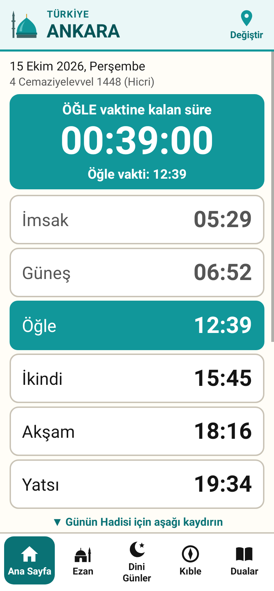 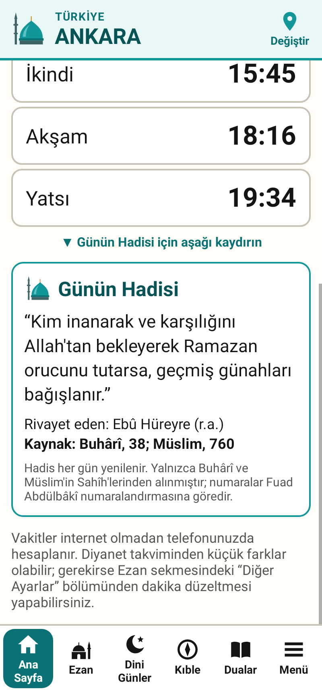 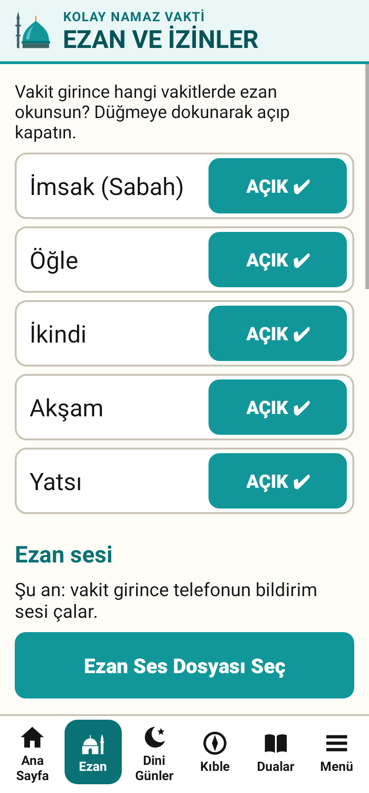
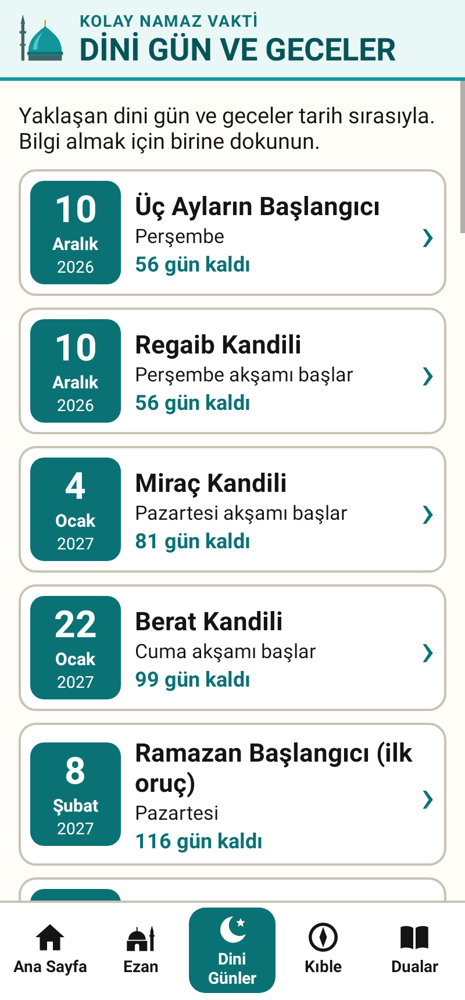  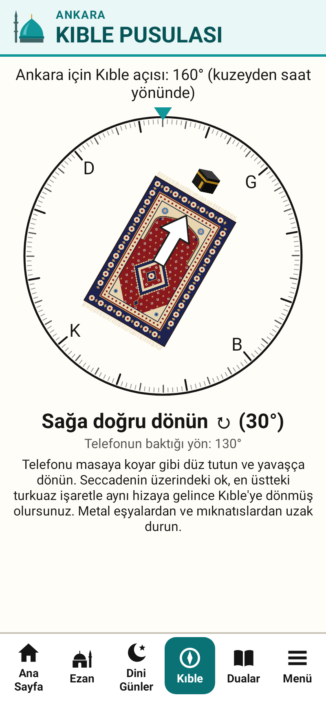 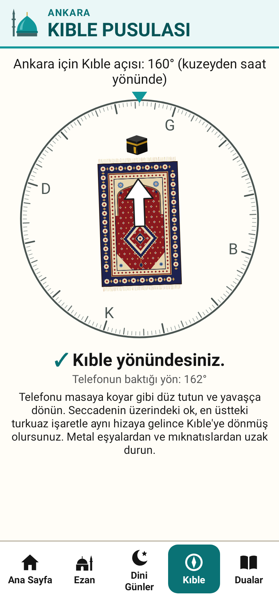 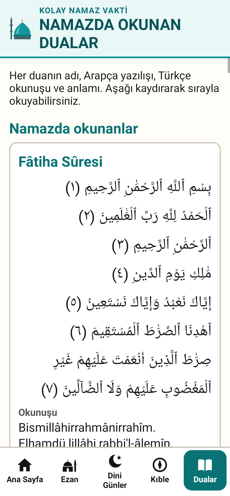

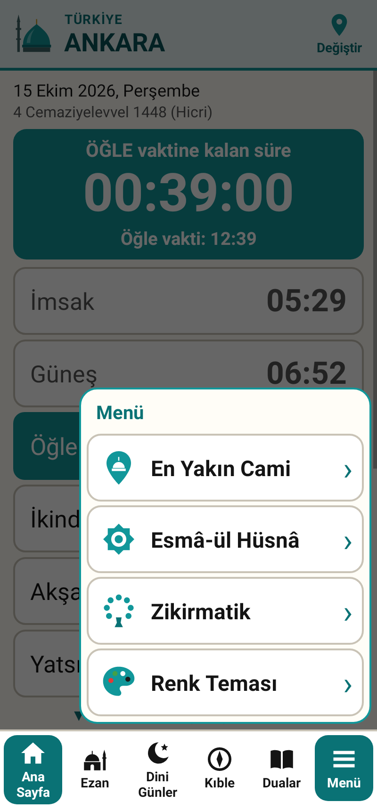 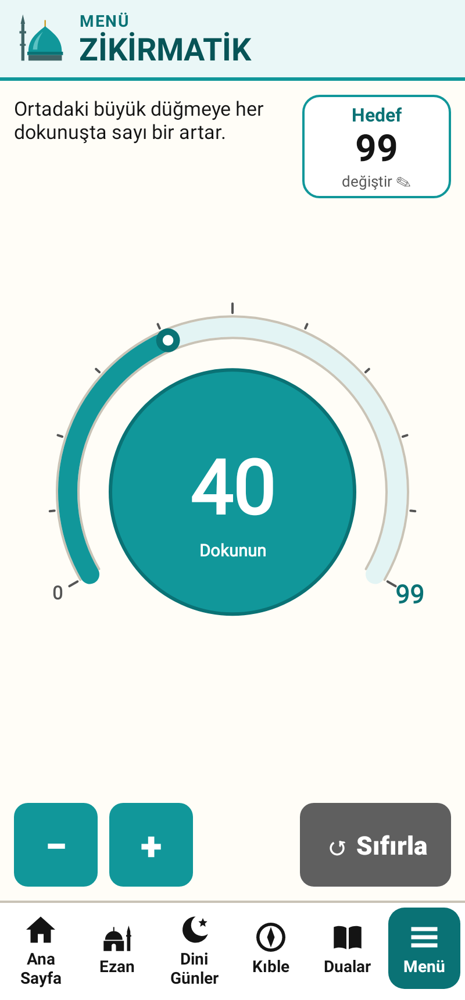 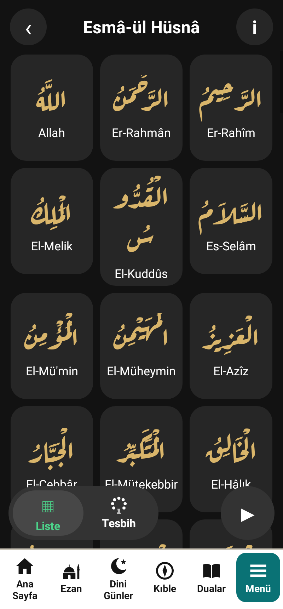  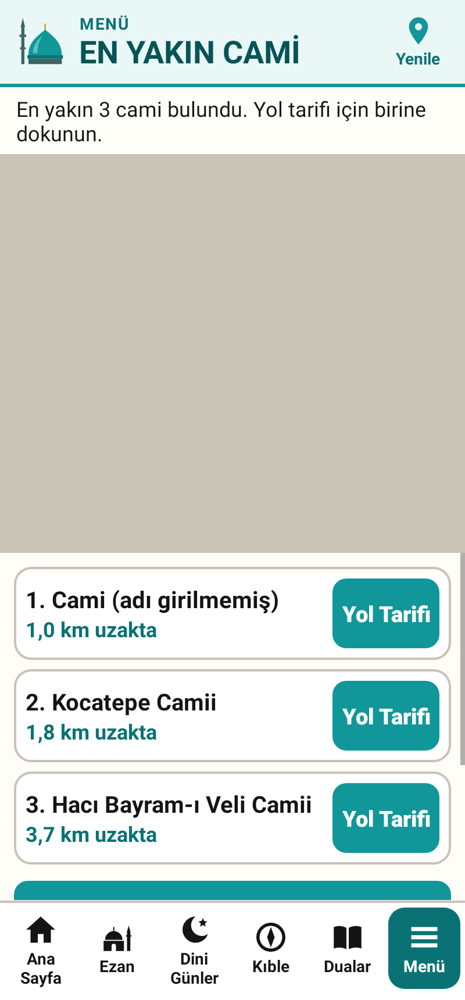
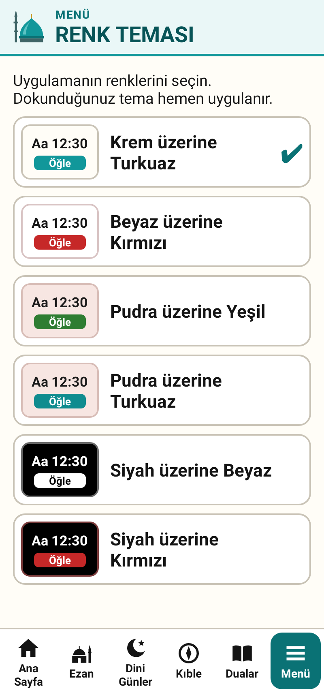 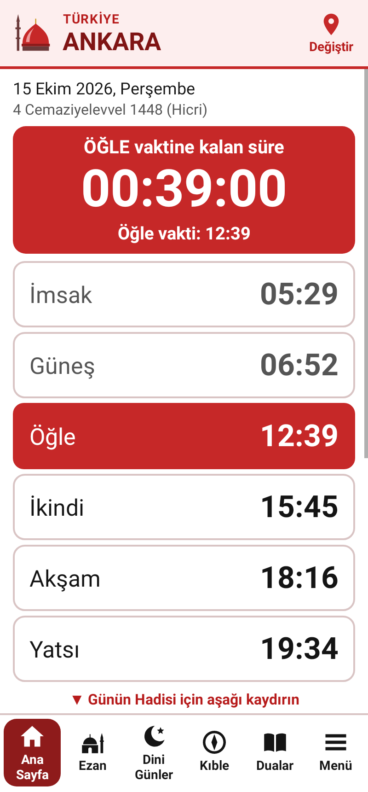 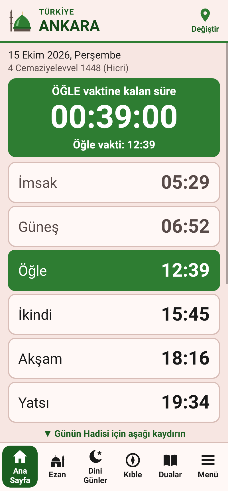 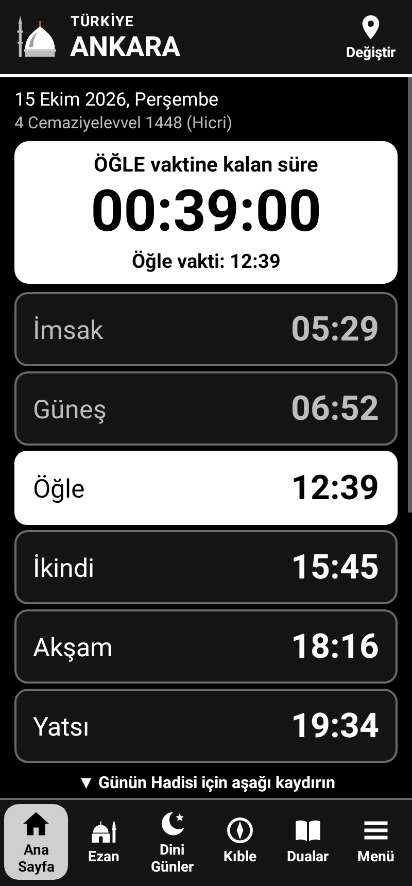 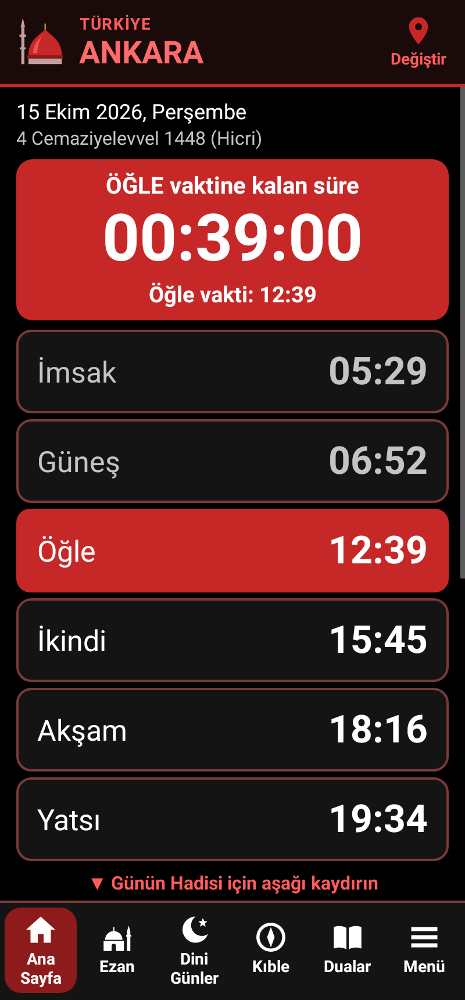

## 2.2 sürümünde neler değişti?

- **Alt menünün en sağına "Menü" düğmesi** eklendi. Dokununca yukarı doğru bir panel açılır:
  - **En Yakın Cami:** Haritada yakınınızdaki camiler görünür. Bir camiye dokunup **Yol Tarifi**'ne basınca Google Haritalar açılır ve yolu tarif eder.
    Haritanın altında en yakın 10 caminin mesafeli listesi de vardır. Cami bilgileri OpenStreetMap'ten gelir.
  - **Esmâ-ül Hüsnâ:** Allah'ın 99 ismi, koyu zemin üzerinde 3 sütunlu kartlarda: altın renkli Arapça isim (açık lisanslı
    Aref Ruqaa hat yazı tipi) ve altında okunuşu. Bir isme dokununca büyük pencerede anlamı açılır ve Arapçası seslendirilir
    (‹ › ile önceki/sonraki isim). Sağ alttaki ▶ 99 ismi sırayla okur, sol alttaki **Tesbih** Zikirmatik'i açar.
  - **Zikirmatik:** Ortada büyük bir düğme; etrafında soldan başlayıp üstten dönerek hedefe doğru dolan bir kadran, kadranın sonunda hedef sayı.
    Sağ üstte hedef (dokunup rakam girilir), sol altta **−** ve **+**, sağ altta **Sıfırla** (önce sorar). Hedefe ulaşınca telefon titrer.
    Sayı uygulama kapansa da kaybolmaz; zikir çekerken ekran kararmaz.
  - **Renk Teması:** Beyaz üzerine Kırmızı, Pudra üzerine Yeşil, Pudra üzerine Turkuaz, Siyah üzerine Beyaz, Siyah üzerine Kırmızı
    (ve eski Krem üzerine Turkuaz). Yazı/zemin karşıtlığı her temada WCAG 2.1 ölçüsüyle kontrol edildi.
- **Hicri tarih artık Diyanet takvimine göre.** Diyanet'in ay başı ölçütü (gün batımında Ay'ın yüksekliği en az 5°, Güneş-Ay açısı en az 8°,
  yeryüzünün herhangi bir yerinde; 2016'dan beri Amerika anakarası istisnası) ile 2025-2032 tablosu hesaplandı. Diyanet'in yayımladığı
  38 ay başının 37'si hesapla aynı çıktı; farklı olan tek ay (1 Ramazan 1447) sınırda bir durumdur. Tabloda Diyanet'in yayımladığı tarihler
  her zaman aynen kullanılır (`tools/hicri_takvim_uret.py`).
- **Dini günler 2030 sonuna kadar uzatıldı** (son kayıt: 26 Aralık 2030, Ramazan başlangıcı). 2029 ve 2030 tarihleri Diyanet'in
  listelerinden alındı; her tarihin haftanın günü Diyanet'in yazdığıyla, Hicri günü de takvim tablosuyla otomatik test edildi.
- **Ezan sesi iyileştirmeleri:** ekran kapalıyken sesin kesilmemesi için işlemci uyanık tutulur, ezan süresince çalan müzik susar,
  "tam vaktinde alarm" izni verildiği anda alarm yeniden kurulur. Uygulamaya hazır ezan sesi eklenebilmesi için altyapı kuruldu (aşağıya bakın).
- Seslendirmede isimlerin sonundaki şedde korunur ("El-Aliyy", "El-Hakk" doğru okunur).

## 2.1 sürümünde neler değişti?

- **Renkler turkuaz oldu.** Ana renk `#11979A`, yazılar ve ince ayrıntılar için koyu turkuaz `#0A7275`.
  Örnek görseldeki açık turkuaz (`#1FB5B7`) üzerinde beyaz yazının karşıtlığı 2,51:1'dir. Bu oran, [WCAG 2.1](https://www.w3.org/TR/WCAG21/#contrast-minimum)
  okunabilirlik kuralının büyük yazılar için istediği 3:1'in altında kalır. Bu yüzden biraz daha koyu bir turkuaz seçildi
  (beyaz yazıyla 3,55:1; koyu turkuaz yazı, beyaz zeminde 5,71:1).
- **Başlıklar yenilendi.** Her sayfanın üstünde solda bir **cami simgesi**, küçük harfle üst başlık (ör. TÜRKİYE),
  altında büyük başlık (ör. ANKARA) var. Ana sayfada sağda **Değiştir** (şehir), dini gün sayfasında **Geri** düğmesi bulunuyor.
- **Ana sayfa ekrana sığıyor.** Vakit satırları ekranın boyuna göre kendini ayarlıyor, 6 vaktin hepsi kaydırmadan görünüyor
  (küçük ekranlı telefon için de test edildi). Sayacın altındaki "saat : dakika : saniye" yazısı kaldırıldı.
- **Kıble pusulası düzeltildi ve yeniden çizildi:**
  - Telefon eğik veya dik tutulduğunda yönün şaşması düzeltildi.
  - Jiroskopu olmayan telefonlarda da çalışıyor.
  - Ekran yan dönünce oluşan kayma giderildi.
  - Pusula ayarı bozuksa uyarı ayrı bir satırda gösteriliyor, yön bilgisini kapatmıyor.
  - Yeni görünüm: çentikli halka, K-D-G-B harfleri, desenli seccade, üstünde Kâbe ve beyaz ok.
    Doğru yöne dönünce "✓ Kıble yönündesiniz." yazıyor.
- **Uygulama simgesi** depo sahibinin verdiği hilal ve cami logosuyla değiştirildi.

## Telefona kurulum (adım adım)

1. Telefonunuzdan bu sayfadaki **`dist/KolayNamazVakti.apk`** dosyasına dokunun, sonra **İndir** (Download) düğmesine basın.
2. İndirme bitince bildirime veya **Dosyalarım → İndirilenler** içindeki `KolayNamazVakti.apk` dosyasına dokunun.
3. Telefon "Bilinmeyen uygulamalar" uyarısı verirse **Ayarlar**'a dokunun, **"Bu kaynağa izin ver"** seçeneğini açın, geri dönün.
4. **Yükle**'ye basın. Google Play Protect uyarı verirse **"Yine de yükle"** deyin (uygulama Google Play'den gelmediği için bu uyarı normaldir).
5. Uygulamayı açın, şehrinizi seçin. Bildirim izni sorulursa **İzin ver** deyin.

> **2.1 veya daha eski bir sürüm kuruluysa:** 2.2 farklı bir imza anahtarıyla imzalandı (önceki anahtar geliştirme ortamında kalmıştı,
> depoya bilerek konmamıştı). Telefon "uygulama yüklenmedi" derse önce eski Kolay Namaz Vakti'yi kaldırın
> (uygulama simgesine basılı tutun → **Kaldır**), sonra yeniden yükleyin. Şehir ve ayarlarınızı yeniden seçmeniz gerekir.
>
> **1.0 sürümü kuruluysa:** Bu sürüm farklı bir imza anahtarıyla imzalandı. Telefon "uygulama yüklenmedi"
> derse önce eski Kolay Namaz Vakti'yi kaldırın (uygulama simgesine basılı tutun → **Kaldır**), sonra yeniden yükleyin.
> Şehir ve ayarlarınızı yeniden seçmeniz gerekir.

**Gereken:** Android 7.0 veya daha yeni bir telefon.

APK dosyasının SHA-256 özeti (dosyanın bozulmadığını kontrol etmek isteyenler için):
`cf8032880b94941b8b7e16e3f684f5684ab476ad6de28f21e6a8dbbb1e810876`

## Neler var?

Ekranın en altında 6 büyük menü düğmesi vardır:

| Düğme | Ne yapar? |
|---|---|
| **Ana Sayfa** | Sıradaki vakte kalan süre büyük yazıyla sayılır (ör. `00:39:00` = saat:dakika:saniye). Altında bugünün 6 vakti (İmsak, Güneş, Öğle, İkindi, Akşam, Yatsı). Sayfayı **aşağı kaydırınca** her gün değişen **"Günün Hadisi"** çıkar. |
| **Ezan** | Her vakit için ezanı **açıp kapatma**, ezan ses dosyası seçme ve deneme, vakitten önce hatırlatma ve ezanın zamanında okunması için gereken **izinlerin durumu** (turkuaz ✔ / kırmızı ✖ ve düzeltme düğmesi). Yazı boyutu ve dakika düzeltmesi de buradan açılır. |
| **Dini Günler** | Yaklaşan dini gün ve geceler tarih sırasıyla, "kaç gün kaldı" bilgisiyle. Birine dokununca **bilgi sayfası** açılır (ne olduğu, ilgili ayet ve hadisler, kaynakları). |
| **Kıble** | Pusula halkasının ortasında Kâbe yönüne dönen desenli bir **seccade**, üstünde Kâbe ve beyaz ok. Ok, en üstteki turkuaz üçgenle aynı hizaya gelince "✓ Kıble yönündesiniz." yazar; değilse "Sağa/Sola doğru dönün (… °)" diye yol gösterir. Pusula ayarı bozuksa telefonu havada 8 çizer gibi sallamanızı söyler. |
| **Menü** (en sağda) | Yukarı doğru açılan panel: **En Yakın Cami** (harita + Google Haritalar yol tarifi), **Esmâ-ül Hüsnâ** (99 isim, Arapça seslendirme), **Zikirmatik**, **Renk Teması**. |
| **Dualar** | Namazda okunan dualar sırayla, **en başta Fâtiha Sûresi**. Her biri için: **adı, Arapça yazılışı, Türkçe okunuşu, Türkçe anlamı**, nerede okunduğu ve kaynağı. Vitir (Kunut) duaları, kısa sûreler (Fîl'den Nâs'a) ve namazdan sonra okunanlar da vardır. |

Ayrıca: ana ekran bileşeni (widget), telefon yeniden açılınca alarmların kendiliğinden kurulması, 3 yazı boyutu, her vakit için −30…+30 dakika düzeltme.

## Ezan sesi nasıl seçilir?

Bu sürümde uygulamanın içinde **hazır ezan kaydı yoktur.** Seçmezseniz vakit girince telefonun bildirim sesi çalar.

Telifsiz (özgür lisanslı) ezan kaydı arandı. Bulunanlar (Wikimedia Commons):
[Beautiful adhan.ogg](https://commons.wikimedia.org/wiki/File:Beautiful_adhan.ogg) (arama sonucuna göre CC0, 2 dk 34 sn) ve
[Azan.ogg](https://commons.wikimedia.org/wiki/File:Azan.ogg) (CC BY-SA 4.0, 3 dk 3 sn). Bu iki kaydın **makamı belirtilmemiş**;
Türk makamlarıyla (Saba, Uşşak, Hicaz, Segâh, Rast) okunmuş ve lisansı açıkça telifsiz olan bir kayıt **bulunamadı**.
Geliştirme ortamından Wikimedia'ya erişim engelli olduğu için dosyalar indirilemedi ve dinlenemedi; lisanslar yalnızca arama sonuçlarından görüldü.
Uygun lisanslı bir kayıt `app/src/main/res/raw/` klasörüne konup `Ezanlar.java`'ya bir satır eklenirse Ezan sayfasında "hazır ezan" düğmesi olarak çıkar.

Telefonunuzda bir ezan ses dosyası (ör. MP3) varsa:

1. Alttaki **Ezan** düğmesine dokunun.
2. **Ezan Ses Dosyası Seç**'e dokunun ve dosyanızı seçin.
3. **▶ Ezanı Dene** ile dinleyin; **■ Durdur** ile susturun.
4. Vakit girince ezan, telefonun **ALARM ses seviyesinde** çalar. Bildirimdeki **Durdur** ile susturabilirsiniz; en fazla 10 dakika çalar.
5. Telefon sessiz/titreşimdeyken ezan **okunmaz** (isterseniz "Telefon sessizdeyken ezan: OKUNUR" yapabilirsiniz). Telefonla konuşurken ezan okunmaz, yalnızca bildirim gelir.

## İçerik nereden geldi, ne kadar doğrulandı?

| İçerik | Kaynak | Doğrulama |
|---|---|---|
| **Günün Hadisi** (54 hadis) | Yalnızca **Buhârî** ve **Müslim**'in Sahîh'leri. Numaralar Fuad Abdülbâkî numaralandırmasıdır. | Her hadisin numarası ve konusu, sunnah.com verisini içeren açık kaynak `hadith` paketindeki (npm, MIT) Arapça asıl ve İngilizce çeviriyle karşılaştırıldı: **54/54 bulundu, hepsi "sahih"** (`tools/hadis_dogrula.py`). Türkçe metinler Arapça asıldan çevrildi; resmî bir Türkçe çeviriden alınmadı. |
| **Fâtiha, kısa sûreler, Rabbenâ duaları, Âyete'l-Kürsî** | Arapça: QuranEnc.com Medine Mushafı metni. Meal: QuranEnc Türkçe çevirisi (npm `quran-cloud` paketi, CC BY 4.0). | Metinler veriden otomatik alındı (`tools/kuran_metni_uret.py`), elle yazılmadı. Mealde yalnızca noktalama eklendi. Diyanet meali **değildir**. |
| **Sübhâneke, Ettehiyyâtü, Salli-Bârik, rükû/secde tesbihleri, selam, Ente's-selâm** | Arapçası, yanında yazan hadisin (Buhârî 831, 3370, 3228; Müslim 591, 772; Tirmizî 243, 261; Ebû Dâvûd 996) Arapça metninden **birebir** alındı. | Okunuş ve anlamlar Türkiye'de yaygın biçimle yazıldı; Diyanet'in resmî metniyle harf harf karşılaştırma **yapılamadı** (Diyanet sitesine bu ortamdan erişilemedi). |
| **Kunut duaları** | Hanefî mezhebinde okunan metin. | Benzer bir metin Hısnü'l-Müslim'de (118) var; Buhârî ve Müslim'de **yoktur**. Uygulamada da böyle yazıyor. |
| **Dini gün tarihleri** (Aralık 2026 – Aralık 2030) | Diyanet İşleri Başkanlığı'nın dini günler listeleri: vakithesaplama.diyanet.gov.tr `icerik.php?icerik=` 153 (2026), 154 (2027), 185 (2028), 186 (2029), 187 (2030). | Resmî sayfalar bu ortamdan doğrudan açılamadı; tarihler **arama motorunun bu sayfalardan gösterdiği satırlardan** alındı. Diyanet'in yazdığı haftanın günleri takvimle birebir tuttu; her Hicri tarih, Hicri takvim tablosuyla otomatik testte karşılaştırıldı. **Kısmen doğrulandı** (resmî sayfa elle açılıp satır satır okunmadı). |
| **Hicri tarih** (ana ekran) | Diyanet'in ay başı ölçütüyle hesaplanan tablo (2025-2032) + Diyanet'in yayımladığı 38 ay başı. Ölçüt: vakithesaplama.diyanet.gov.tr (icerik=101) ve Din İşleri Yüksek Kurulu'nun 18 Şubat 2026 tarihli Ramazan açıklaması. | Hesap, Diyanet'in yayımladığı 38 ay başının 37'sini doğru buldu. Listelerde geçmeyen aylar (Safer, Rebiülahir, Cemaziyelevvel, Cemaziyelahir, Zilkade) **hesaptır**, Diyanet'ten 1 gün farklı olabilir. 2032 sonrası Ümmü'l-Kurâ'ya göre "yaklaşık" yazılır. |
| **Esmâ-ül Hüsnâ** | Arapça isimler ve sırası: Tirmizî, Daavât, 3507 hadisinin Arapça metninden programla alındı (`tools/esma_uret.py`, npm `hadith` verisi). | Arapça: 99/99 isim hadis metninden aynen. Türkçe okunuş ve anlamlar yaygın kullanıma göre kısa yazıldı; resmî bir Diyanet metniyle **karşılaştırılmadı**. Seslendirme telefonun Arapça metin okuma motoruyla yapılır; telaffuz telefona göre değişir ve **gerçek telefonda dinlenmedi**. |
| **Camiler** (En Yakın Cami) | OpenStreetMap (© katkıda bulunanlar, ODbL) — Overpass API ile canlı sorgu; harita: Leaflet 1.9.4 (BSD-2). | OSM'ye girilmemiş camiler görünmez. Bu ortamdan OSM sunucularına erişim engelli olduğu için **canlı sorgu denenemedi**; cevabın işlenmesi örnek veriyle, harita sayfası tarayıcıda test edildi. |
| **Namaz vakitleri** | Telefonda astronomik hesap (`PrayerCalc.java`), açık kaynak [adhan](https://github.com/batoulapps/adhan-js) (MIT) kütüphanesinin "Turkey" yöntemiyle aynı ayarlar. | 81 il × 26 tarih adhan ile karşılaştırıldı, en büyük fark 1 dakika. Diyanet'in resmî takvimiyle karşılaştırma **yapılamadı**. |

## Bilinen sınırlamalar

- Hazır ezan kaydı yoktur (yukarıya bakın). Kendi ses dosyanızı seçebilirsiniz; seçmezseniz bildirim sesi çalar.
- **Google Play'e yüklenecekse:** uygulama "tam vaktinde alarm" için `USE_EXACT_ALARM` iznini kullanır. Google Play bu izni yalnızca ana işi
  alarm/takvim olan uygulamalara verir; namaz vakti uygulaması için kabul edilip edilmeyeceği **belli değildir**. Play'e yüklemeden önce
  `AndroidManifest.xml`'den `USE_EXACT_ALARM` satırını silip `SCHEDULE_EXACT_ALARM` satırındaki `maxSdkVersion` kısmını kaldırın; uygulama
  bu durumda kullanıcıdan izni Ezan sayfasındaki "İzin Ver" düğmesiyle ister (Android 14'te bu izin varsayılan olarak kapalıdır).
  APK'yı kendiniz kuruyorsanız bir şey yapmanız gerekmez.
- En Yakın Cami sayfası internet ve (isterseniz) konum ister. Konum izni verilmezse seçili şehrin merkezine göre arar.
- İl merkezi seçildiğinde vakitler il merkezine göredir; ilçelerde birkaç dakika fark olabilir. "Konumumu Otomatik Bul" kullanılırsa
  vakitler tam bulunduğunuz yere göre hesaplanır.
- Android 12 ve üzerinde, telefon pil tasarrufundayken sistem, seçtiğiniz ezan sesinin arka planda başlatılmasına izin vermeyebilir.
  Bu durumda uygulama otomatik olarak bildirim sesine geçer. Bunun hangi telefonlarda ve ne sıklıkla olduğunu **doğrulayamadım**;
  Ezan sayfasındaki **Pil tasarrufu** satırından kısıtlamayı kaldırmanız önerilir.
- Bazı telefonlarda (özellikle Xiaomi, Huawei, Samsung) pil tasarrufu bildirimleri geciktirebilir.
- Uygulama "Zorla durdur" yapılırsa ezan ve bildirimler, uygulama tekrar açılana kadar gelmez (Android kuralı).
- Hicri tarihte Diyanet'in yayımlamadığı aylar hesaptır; nadiren 1 gün farklı olabilir.
- Dini gün listesi 2030 sonuna kadardır.
- Bu sürüm **gerçek bir telefonda denenmedi**: ezanın çalması, ana ekran bileşeni, pusula, harita ve seslendirme yalnızca otomatik testlerle
  (Robolectric) ve tarayıcıda denendi.
- Kıble pusulası telefonun manyetik sensörüyle çalışır. Hesap otomatik testlerde (düz, eğik, dik, yan tutuş ve jiroskopsuz telefon)
  doğrulandı, ancak **gerçek bir telefonda denenmedi**. Metal eşyalar, mıknatıslı kılıflar ve hoparlörler pusulayı şaşırtabilir.
- APK, bu depodaki kodla geliştirme ortamında üretilen bir anahtarla imzalanmıştır. Sonraki sürümler farklı anahtarla imzalanırsa
  güncellemeden önce eski uygulamayı kaldırmanız gerekir.

## Geliştiriciler için

```bash
# Araçlar (Ubuntu 24.04): sudo apt install aapt dalvik-exchange zipalign apksigner default-jdk
# android.jar yerine Robolectric'in Android 14 çerçeve jar'ı da kullanılabilir (Maven Central):
#   https://repo1.maven.org/maven2/org/robolectric/android-all/14-robolectric-10818077/
ANDROID_JAR=/yol/android-all-14-robolectric-10818077.jar ./build.sh     # → build/KolayNamazVakti.apk

# Otomatik testler (telefon gerekmez, Robolectric ile; 77 test, ekran görüntülerini de üretir):
ANDROID_JAR=... AXT_SHIM_JAR=... ./test.sh
# Esmâ-ül Hüsnâ yazı tipi: npm @expo-google-fonts/aref-ruqaa 0.4.1 → assets/fonts (SIL OFL 1.1)
```

- `app/src/main` — uygulama kaynak kodu (saf Java, dış kütüphane yok).
  - `MainActivity` alt menü ve sayfaları yönetir: `HomePage`, `AdhanPage`, `DaysPage`, `QiblaPage`, `DuasPage`;
    Menü paneli: `CamiPage` (harita: `assets/harita`, Leaflet 1.9.4), `EsmaPage`, `ZikirPage` + `ZikirView`, `TemaPage`.
  - Renk temaları: `res/values/styles.xml` + `attrs.xml`, seçim `Tema.java`.
  - Hicri takvim: `HicriTablo.java` (otomatik üretilir), `Times.hijriDiyanet`.
  - İçerik: `Hadisler.java`, `Dualar.java`, `KuranMetni.java` (otomatik üretilir), `DiniGunler.java`.
  - Ezan: `AlarmScheduler` (kesin alarm) → `AlarmReceiver` → `AdhanService` (ön plan medya servisi) veya `Notifier`.
- `tools/robotest` — otomatik testler; ekran görüntülerini `docs/ekran-goruntuleri` içine yazar.
- `tools/hadis_dogrula.py` — Günün Hadisi listesini hadis veritabanıyla karşılaştırır (Ekim 2026'da yeniden çalıştırıldı: 54/54, 0 hata).
- `tools/hicri_takvim_uret.py` — `HicriTablo.java`'yı Diyanet ölçütüyle üretir, Diyanet'in yayımladığı ay başlarıyla karşılaştırır.
- `tools/esma_uret.py` — `Esma.java`'yı Tirmizî 3507'nin Arapça metninden üretir.
- `tools/kuran_metni_uret.py` — `KuranMetni.java` dosyasını Kur'an verisinden üretir.
- `tools/seccade_uret.py` — Kıble sayfasındaki seccade ve Kâbe resimlerini (`res/drawable-nodpi`) kodla çizer (Python + Pillow).
- `tools/simge_uret.py` — uygulama simgelerini (`res/mipmap-*`) `docs/logo/uygulama-logosu-kaynak.jpg` dosyasındaki logodan üretir.
- `tools/referans_uret.js` — adhan kütüphanesinden vakit karşılaştırma verisi üretir.
- `tools/ekran_vakit_karsilastir.js` — Ezan Vakti Pro tanıtım görselindeki vakitleri adhan yöntemleriyle karşılaştırır.
- `tools/axt-shim` — Google Maven'e erişilemeyen ortamda Robolectric için `androidx.test` monitor kütüphanesini kaynak koddan derler
  (kaynak: github.com/android/android-test, etiket `axt_08_14_2024`; derlenen jar'a `ExposedInstrumentationApi.class` elle eklenir).
- `RAPOR.md` — rakip uygulamaların (Ezan Vakti Pro, Namaz Vakitleri) analiz raporu (2. sürüm).
