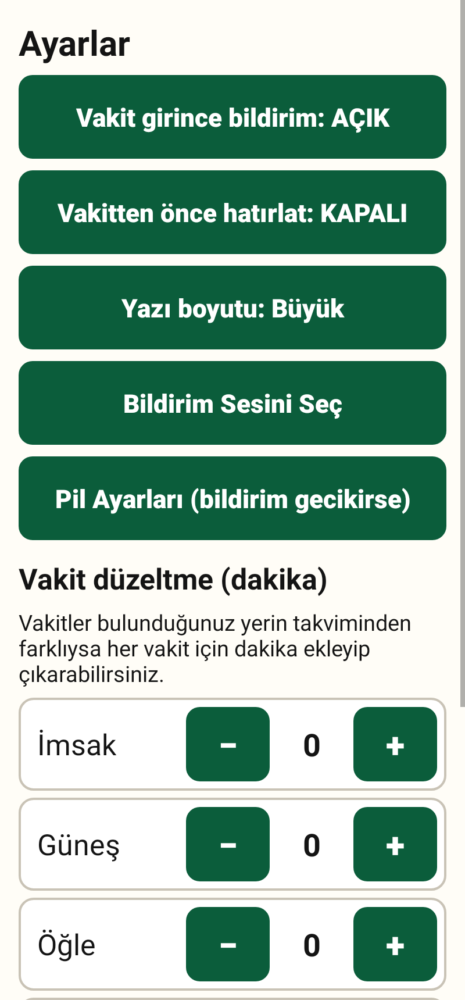

# Kolay Namaz Vakti

Yaşlıların da rahatça kullanabileceği, **büyük yazılı ve sade** bir namaz vakti uygulaması (Android).

  

## Telefona kurulum (adım adım)

1. Telefonunuzdan bu sayfadaki **`dist/KolayNamazVakti.apk`** dosyasına dokunun, sonra **İndir** (Download) düğmesine basın.
2. İndirme bitince bildirime veya **Dosyalarım → İndirilenler** içindeki `KolayNamazVakti.apk` dosyasına dokunun.
3. Telefon "Bilinmeyen uygulamalar" uyarısı verirse **Ayarlar**'a dokunun, **"Bu kaynağa izin ver"** seçeneğini açın, geri dönün.
4. **Yükle**'ye basın. Google Play Protect uyarı verirse **"Yine de yükle"** deyin (uygulama Google Play'den gelmediği için bu uyarı normaldir).
5. Uygulamayı açın, şehrinizi seçin. Bildirim izni sorulursa **İzin ver** deyin.

**Gereken:** Android 7.0 veya daha yeni bir telefon.

APK dosyasının SHA-256 özeti (dosyanın bozulmadığını kontrol etmek isteyenler için):
`33b8af13cc513521b343320fc463d62411910d6dc2d50e15ea908440af698762`

## Neler var?

| Özellik | Açıklama |
|---|---|
| Ana ekran | Bugünün 6 vakti (İmsak, Güneş, Öğle, İkindi, Akşam, Yatsı) **40 punto** büyüklüğünde. Sıradaki vakit yeşil, geçen vakitler gri. |
| Kalan süre | "Sıradaki vakit: ÖĞLE — 39 dakika kaldı" kutusu |
| Tarih | Miladi tarih + Hicri tarih |
| Şehir | 81 il listesi, arama kutusu ("izmir" yazmak yeterli), "Konumumu Otomatik Bul" düğmesi |
| Bildirim | Vakit girince sesli/titreşimli bildirim (Güneş hariç). Ses, telefonun bildirim sesidir; Ayarlar → "Bildirim Sesini Seç" ile değiştirilebilir. |
| Hatırlatma | Vakitten 10/15/30/45 dakika önce hatırlatma |
| Yazı boyutu | Büyük / Daha büyük / En büyük |
| Dakika düzeltme | Her vakit için −30…+30 dakika |
| Kıble | Pusula ile Kâbe yönünü gösteren büyük ok |
| Widget | Ana ekrana eklenebilen "sıradaki vakit" kutusu |
| Telefon yeniden açılınca | Alarmlar otomatik yeniden kurulur |
| **İnternet** | **Gerekmez. Uygulamanın internet izni yoktur; reklam ve takip yoktur.** |

## Vakitler nasıl hesaplanıyor?

Vakitler telefonda, astronomik formüllerle hesaplanır (`PrayerCalc.java`). Türkiye ayarları, yaygın kullanılan
açık kaynak [adhan](https://github.com/batoulapps/adhan-js) (MIT) kütüphanesindeki "Turkey" yöntemiyle aynıdır:
imsak 18°, yatsı 17°, ikindi standart (gölge = 1 boy), dakika düzeltmeleri güneş −7, öğle +5, ikindi +4, akşam +7.

**Doğrulanan:** 81 il × 26 tarih = 12.636 vakit adhan kütüphanesiyle karşılaştırıldı: %92'si birebir aynı, en büyük fark 1 dakika.

**Doğrulanamayan:** Diyanet İşleri Başkanlığı'nın resmî takvimiyle karşılaştırma **yapılamadı** (geliştirme ortamından
Diyanet sitesine erişim engelliydi). Bu yüzden kendi şehrinizde birkaç gün Diyanet takvimiyle karşılaştırmanız ve
gerekirse Ayarlar → "Vakit düzeltme" bölümünü kullanmanız önerilir.

İl merkezi koordinatları [GeoNames](https://www.geonames.org/) (CC BY 4.0) veritabanından alınmıştır.

## Bilinen sınırlamalar

- Ezan sesi kayıtlı değildir (telif nedeniyle). Bildirim, telefonun seçili bildirim sesini çalar.
- Hicri tarih Ümmü'l-Kurâ takvimine göredir; Diyanet takviminden 1 gün farklı olabilir.
- Dini günler listesi yoktur.
- Bazı telefonlarda (özellikle Xiaomi, Huawei, Samsung) pil tasarrufu bildirimleri geciktirebilir.
  Ayarlar → "Pil Ayarları" düğmesinden uygulamayı kısıtlama dışında bırakın.
- Uygulama "Zorla durdur" yapılırsa bildirimler, uygulama tekrar açılana kadar gelmez (Android kuralı).
- APK, bu depodaki kodla geliştirme ortamında üretilen bir anahtarla imzalanmıştır. Sonraki sürümler farklı anahtarla
  imzalanırsa güncellemeden önce eski uygulamayı kaldırmanız gerekir.

## Geliştiriciler için

```bash
# APK üretmek (Ubuntu): sudo apt install aapt dalvik-exchange zipalign apksigner default-jdk
ANDROID_JAR=/yol/android-34/android.jar ./build.sh          # → build/KolayNamazVakti.apk

# Otomatik testler (telefon gerekmez, Robolectric ile):
ANDROID_JAR=... AXT_SHIM_JAR=... ./test.sh
```

- `app/src/main` — uygulama kaynak kodu (saf Java, dış kütüphane yok).
- `tools/robotest` — 31 otomatik test; ekran görüntülerini `docs/ekran-goruntuleri` içine yazar.
- `tools/referans_uret.js` — adhan kütüphanesinden karşılaştırma verisi üretir.
- `tools/axt-shim` — Google Maven'e erişilemeyen ortamda Robolectric için `androidx.test` monitor kütüphanesini kaynak koddan derler.
- `tools/ekran_vakit_karsilastir.js` — Ezan Vakti Pro tanıtım görselindeki vakitleri adhan kütüphanesinin yöntemleriyle karşılaştırır.
- `RAPOR.md` — rakip uygulamaların (Ezan Vakti Pro, Namaz Vakitleri) analiz raporu (2. sürüm).
